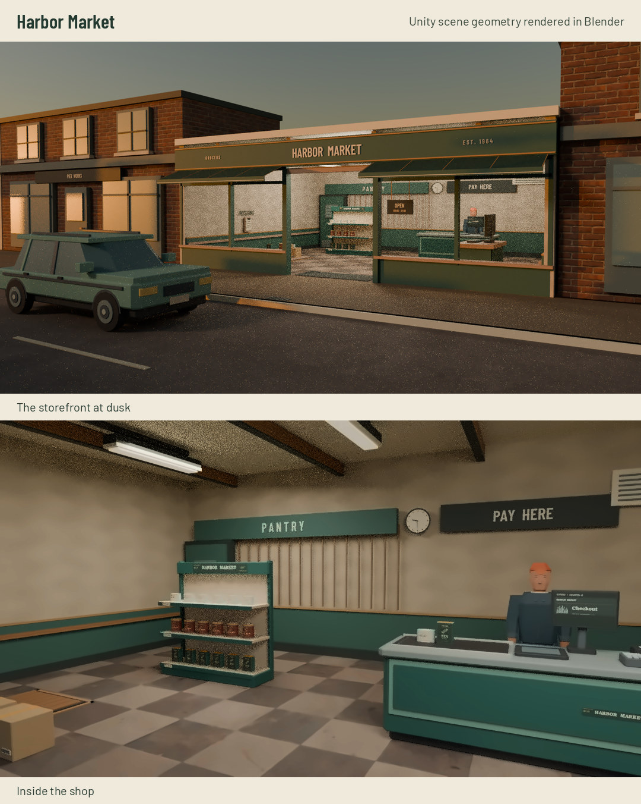

# Qofeno Simulation for Android

Run Harbor Market on the quay. Carry cartons from receiving, stock the shelves, scan a shopper’s purchase and accept card payment. Use the shop computer to order another case before the next customer arrives. Qofeno is built with Unity 6 and C# for ARM64 Android phones.

## Download and install

1. Open the [Unity Android builds](https://github.com/SohailKhan0525/simulationgame/actions/workflows/unity-android.yml). Select a successful published build and use **Download Qofeno for Android** in its summary. The file is named **Qofeno-Harbor-Market.apk**.
2. Open the APK from Downloads on an ARM64 Android phone running Android 7.1 or later and tap **Install**.

Unity previews appear with a `unity-android-` tag on the [Releases page](https://github.com/SohailKhan0525/simulationgame/releases?q=unity-android-). Older `internal-` tags belong to the retired prototype. If no Unity build is green yet, see [Android build setup](UnityQofeno/README.md#build-on-github).

## Build the game locally

The [C# checks](https://github.com/SohailKhan0525/simulationgame/actions/workflows/unity-retail.yml) provide a **Qofeno-Unity-Editor-source** artifact with the project for a computer. Extract the project ZIP to build locally.

1. In Unity Hub, install **6000.3.6f1** with **Android Build Support**, **Android SDK & NDK Tools**, and **OpenJDK**.
2. Open the [UnityQofeno project](UnityQofeno) in the activated editor.
3. Choose **Qofeno → Build Android APK**. Copy `UnityQofeno/Builds/Android/Qofeno-Harbor-Market.apk` to the phone and open it.

[Player controls and project guide](UnityQofeno/README.md) · [C# gameplay source](UnityQofeno/Assets/Qofeno/Runtime) · [Editable models](UnityQofeno/ArtSource/HarborMarketModels.glb) · [Art credits](docs/ASSET_LICENSES.md)

