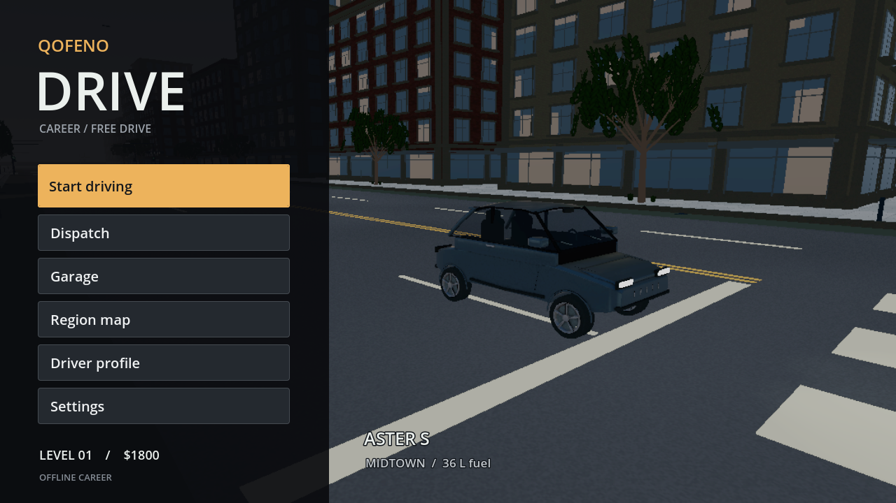
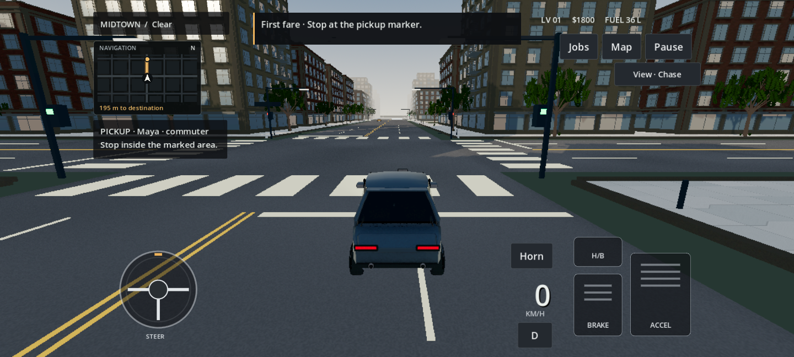
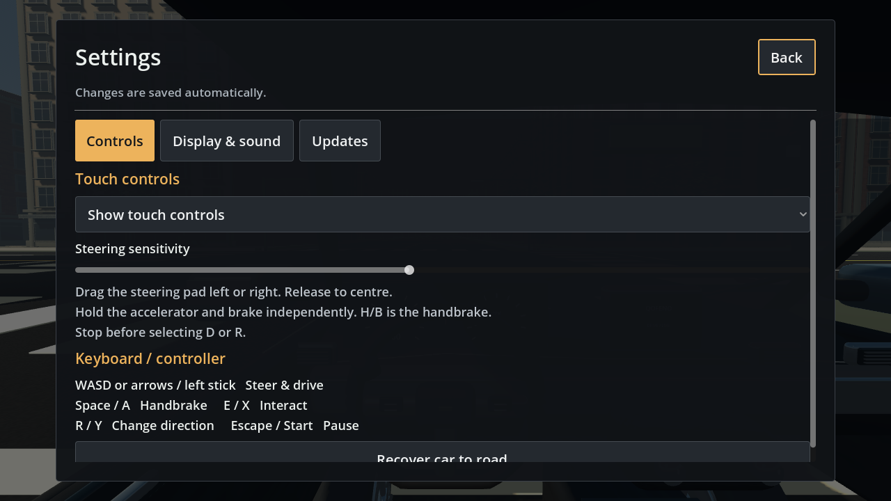
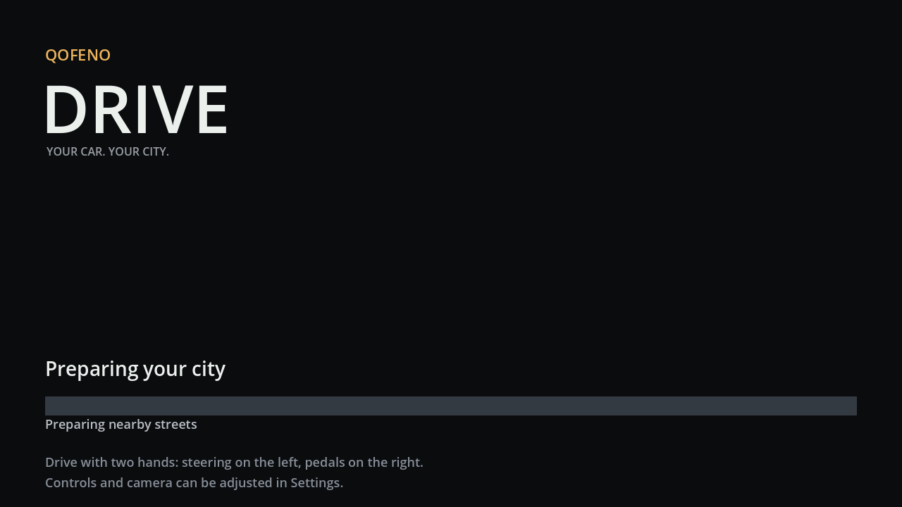

# Mobile graphics validation

Godot 4.5.1 and Blender 4.3.2, 24 November 2026. The local headless import succeeds and all nine game suites pass: session36, world27, vehicle15, touch18, handling9, vehicle presentation38, render profile23, UI flow237, and the smoke flow. The three release-version tests also pass.

The art validator decodes all twelve 1024² PBR maps and validates thirteen GLBs, 45,084 triangles, four wheel origins, normals, UVs, indices, and PBR data. All thirteen runtime PNGs use mipmapped VRAM compression. The Blender exports contain no duplicate embedded texture images.

The native workstation cannot initialize Vulkan (`VK_KHR_surface` is unavailable). Its fallback render is explicitly Compatibility/OpenGL and cannot establish Mobile-renderer behavior. GitHub Actions additionally runs a real software Vulkan rendering-device check and captures the complete game under the Mobile renderer. Headless configuration checks alone are not accepted as Vulkan rendering proof.

The previous signed Android workflow stopped before building because the repository's `QOFENO_KEYSTORE_PASSWORD` secret was missing. The signing identity remains unchanged; no debug-signing fallback is used.

See [MOBILE_GRAPHICS.md](MOBILE_GRAPHICS.md) for the AgX/ACES and live-probe resolution constraints and physical-device test procedure. The 60 FPS cap is a target, not a measured Android performance claim.

## Previous UI rework validation

Godot 4.5.1 stable (f62fdbde1), Compatibility renderer, 60 Hz physics.

- 36 session checks: jobs, pickup/drop-offs, economy, XP, 20-level cap, fuel, cars, upgrades, races, save round trips, corruption backup.
- 27 world checks: bounded 9/25/49-tile streaming, unload/reload, colliders, station placement, signal phases, weather, map boundary, and moving rival completion.
- 15 vehicle checks: stable suspension, acceleration, braking, reverse, steering/upright recovery, fuel/RPM, respawn, passenger visibility, car configuration.
- 18 touch-input checks: independent finger ownership, steering/pedal overlap, release outside the original region, cancellation, and clearing inactive controls.
- 9 handling checks: progressive steering, centering, speed-sensitive wheel lock, braking priority, and changing direction near a stop.
- 215 UI-flow checks: menu and gameplay navigation, settings return destination, pause/suspend cleanup, reverse selection, keyboard/gamepad bindings, focus, scrolling, race offers, and three screen sizes.
- 3 release-version checks: monotonic Android version codes and consistent version metadata.
- Main scene smoke: boot/loading, continue, vehicle input, pause, settings/update state, garage, dispatch, map, passenger pickup and save.
- Native desktop rendering: loading, menu, cockpit, touch HUD, both settings tabs, garage, map, and wide touch HUD captured using the exact Godot 4.5.1 binary and Mesa software OpenGL. No game script or shader errors in the final capture. Balanced scene measured 489 menu / 583 cockpit / 606 touch-HUD draw calls at 1280 × 720, and 655 for the wide touch view at 1440 × 648. These are scene measurements, not a mobile FPS benchmark. The renderer reported unsupported VSync switching and the desktop lacked the speech library.
- Blender 4.3.2 generated the committed cabin and streetscape source files; their GLB exports import successfully in Godot. Original materials and textures are included.
- All checks above passed on 24 November 2026. Test careers/settings use isolated files and do not replace a player's progress. The pull-request workflow repeats the seven Godot suites and release-version tests.

The Android updater, signing material, release automation, and migration scripts were not changed or revalidated in this revision. No APK release or history migration was performed.

## Captured screens

These are actual game renders, not concept images.

## Still requires device testing

Physical-device frame pacing, thermals, battery drain, multi-touch, spoken voice availability, audio mixing, DownloadManager resumption, unknown-source permissions, and an actual older-to-newer APK installation have not been validated on an Android phone. Desktop physics/render tests do not prove those properties. No claim of elite simulation or photorealism is made: this is an original procedural first playable.

The region is a fictional 28 × 28 km grid, not surveyed New York geometry. Building physics means collision boundaries, not destructible structural simulation. Mirrors are decorative. Only the nearby world exists as rendered geometry; world coordinates currently remain within ±14 km rather than using floating-origin rebasing.
